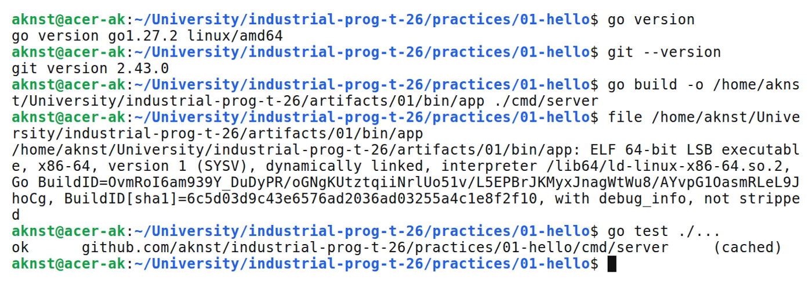
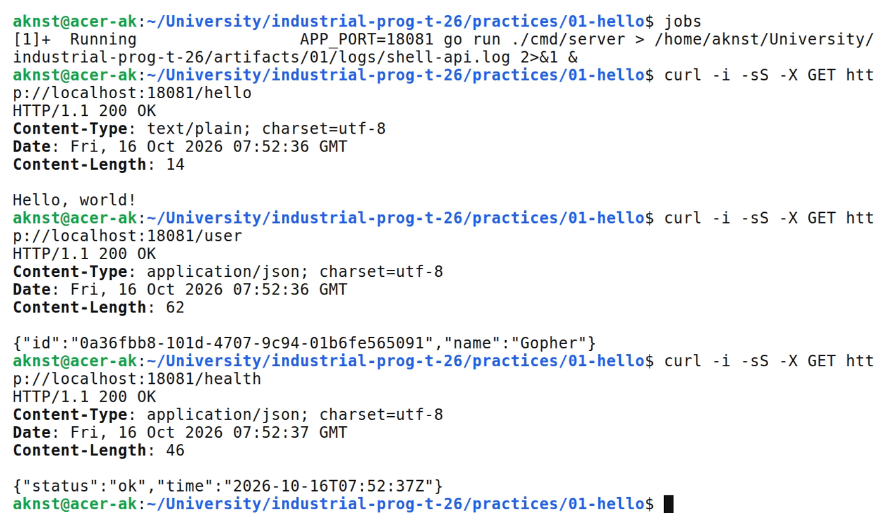

# Установка и настройка окружения Go

**Цель:** Создать HTTP-сервис на Go, подключить библиотеку UUID и проверить сборку под Linux.

**Выполнил:** студент Арефьев К. В., группа ЭФМО-01-26.

**Окружение и исходники:** Ubuntu 24.04, WSL 2, Linux x86_64; go version go1.27.2 linux/amd64.

[https://github.com/aknst/industrial-prog-t-26/tree/main/practices/01-hello](https://github.com/aknst/industrial-prog-t-26/tree/main/practices/01-hello)

**Реализация:**

Создан сервер с маршрутами /hello и /user. Ответ /user содержит JSON с UUID из библиотеки github.com/google/uuid.

Добавлен /health. Порт задаётся через APP_PORT, по умолчанию 8080.

Файл `cmd/server/main.go`.

```go
    mux.HandleFunc("GET /user", func(w http.ResponseWriter, r *http.Request) {
        w.Header().Set("Content-Type", "application/json; charset=utf-8")
        json.NewEncoder(w).Encode(struct {
            ID   string `json:"id"`
            Name string `json:"name"`
        }{uuid.NewString(), "Gopher"})
    })
```

Зависимость зафиксирована в go.mod и go.sum. Проверены запуск через go run, сборка ELF и тест UUID.

**Проверка:**

В таблице 1 представлены результаты запросов.

| Метод и маршрут | Ожидалось | Получено |
| :--- | :---: | :---: |
| `GET /hello` | 200 | 200 |
| `GET /user` | 200 | 200 |
| `GET /health` | 200 | 200 |

Выполнены go vet и go test.

На рисунке 1 представлен вывод команд.



*Рисунок 1 — Версии инструментов, сборка ELF и проверка Go*

На рисунке 2 представлен вывод команд.



*Рисунок 2 — Ответы маршрутов hello, user и health*

**Вывод:** Сервис работает, UUID формируется. Linux-бинарник собран, тесты пройдены.
