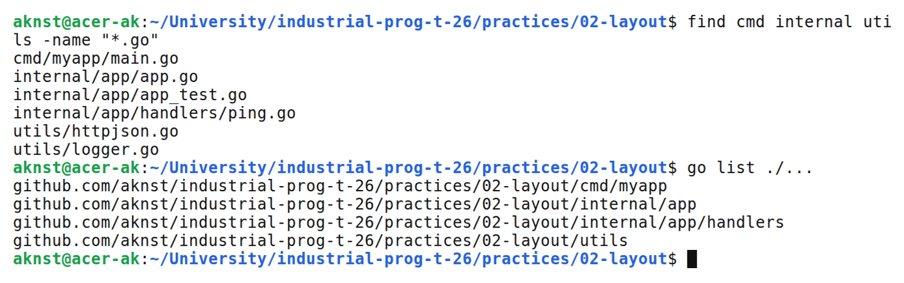
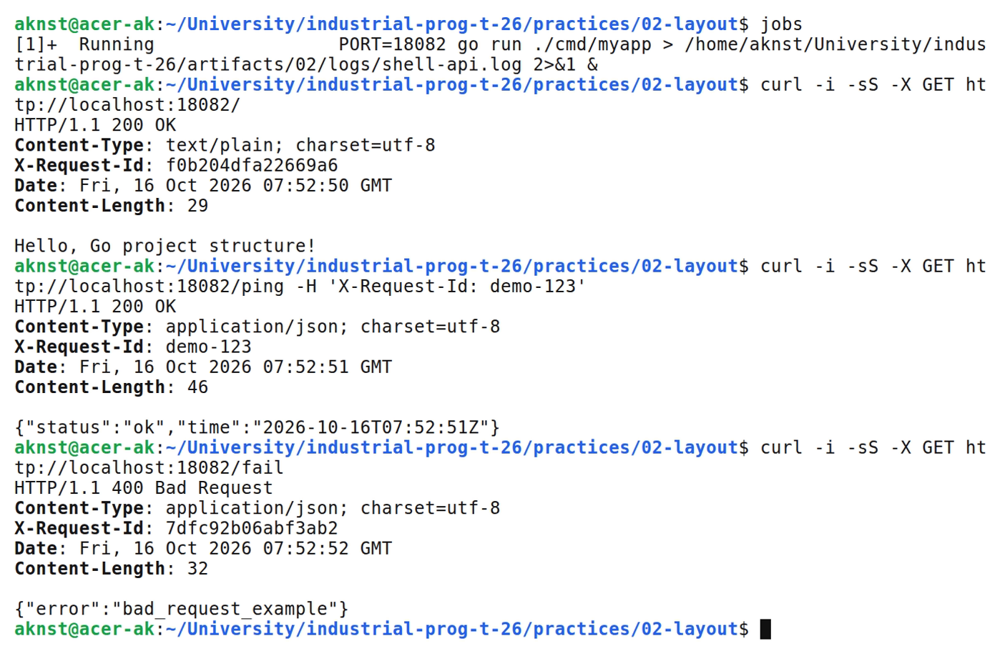

# Структура Go проекта

**Цель:** Разделить Go-приложение на пакеты и проверить маршруты и логирование.

**Выполнил:** студент Арефьев К. В., группа ЭФМО-01-26.

**Окружение и исходники:** Ubuntu 24.04, WSL 2, Linux x86_64; go version go1.27.2 linux/amd64.

[https://github.com/aknst/industrial-prog-t-26/tree/main/practices/02-layout](https://github.com/aknst/industrial-prog-t-26/tree/main/practices/02-layout)

**Реализация:**

main.go вызывает app.Run. Сервер находится в internal/app, обработчик /ping — в internal/app/handlers.

Файл `cmd/myapp/main.go`.

```go
func main() { app.Run() }
```

В utils вынесены JSON-ответы и логирование. Middleware сохраняет X-Request-Id или создаёт новый.

Файл `utils/logger.go`.

```go
func Logging(next http.Handler) http.Handler {
    return http.HandlerFunc(func(w http.ResponseWriter, r *http.Request) {
        start := time.Now()
        id := r.Header.Get("X-Request-Id")
        if id == "" {
            id = NewID16()
        }
        w.Header().Set("X-Request-Id", id)
        log.Printf("request_id=%s remote=%s method=%s path=%s", id, r.RemoteAddr, r.Method, r.URL.Path)
        next.ServeHTTP(w, r)
        log.Printf("request_id=%s elapsed=%s", id, time.Since(start))
    })
}
```

API-контракт размещается в api, чтобы отделить интерфейс от кода. Примеры конфигурации относятся к configs. Миграции хранятся в migrations для контроля версий схемы. Тестовые данные помещаются в testdata. Документация размещается в docs.

Проверены маршруты /, /ping, /fail и заголовок X-Request-Id.

**Проверка:**

В таблице 1 представлены результаты запросов.

| Метод и маршрут | Ожидалось | Получено |
| :--- | :---: | :---: |
| `GET /` | 200 | 200 |
| `GET /ping` | 200 | 200 |
| `GET /fail` | 400 | 400 |

Выполнены go vet и go test.

На рисунке 1 представлен вывод команд.



*Рисунок 1 — Структура исходников и список пакетов*

На рисунке 2 представлен вывод команд.



*Рисунок 2 — Маршруты, Request ID и JSON ошибка*

**Вывод:** Код разделён на пакеты. Маршруты, логирование и Request ID проверены.
