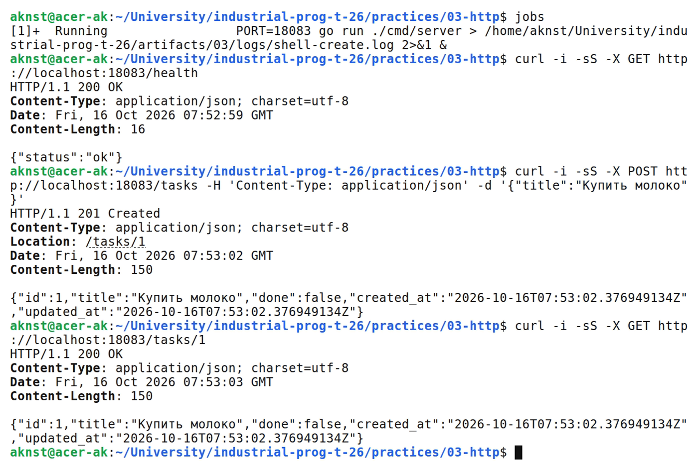
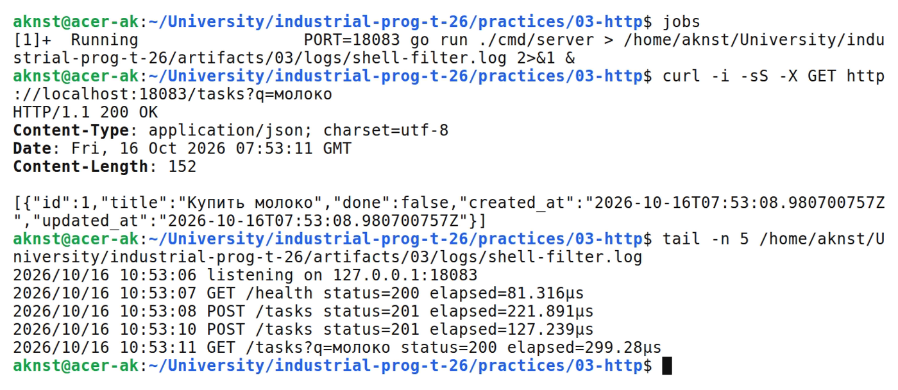
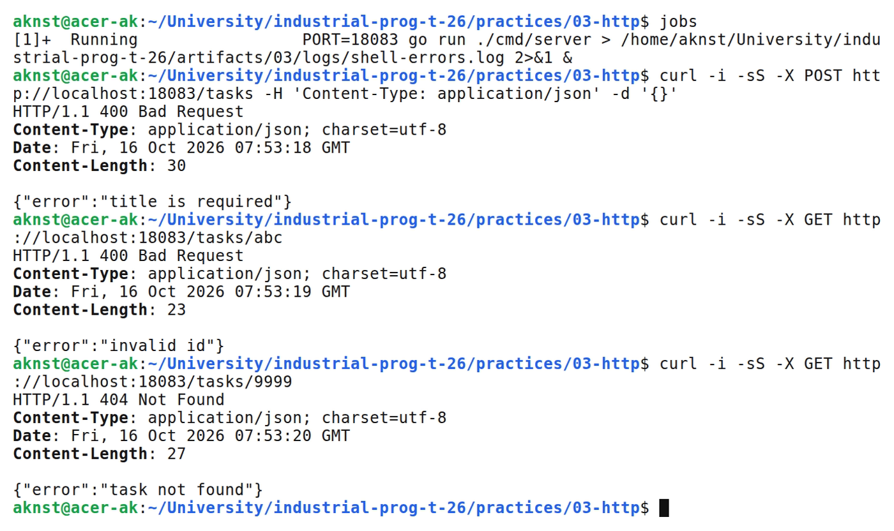

# HTTP сервер на net/http и обработка GET и POST

**Цель:** Реализовать GET/POST API задач на net/http с обработкой ошибок.

**Выполнил:** студент Арефьев К. В., группа ЭФМО-01-26.

**Окружение и исходники:** Ubuntu 24.04, WSL 2, Linux x86_64; go version go1.27.2 linux/amd64.

[https://github.com/aknst/industrial-prog-t-26/tree/main/practices/03-http](https://github.com/aknst/industrial-prog-t-26/tree/main/practices/03-http)

**Реализация:**

Реализованы GET /health, GET /tasks, POST /tasks и GET /tasks/{id} на http.ServeMux.

Файл `internal/api/handlers.go`.

```go
func NewRouter() http.Handler {
    h := &Handlers{Store: storage.NewMemoryStore()}
    mux := http.NewServeMux()
    mux.HandleFunc("GET /health", func(w http.ResponseWriter, r *http.Request) {
        JSON(w, 200, map[string]string{"status": "ok"})
    })
    mux.HandleFunc("GET /tasks", h.List)
    mux.HandleFunc("POST /tasks", h.Create)
    mux.HandleFunc("GET /tasks/{id}", h.Get)
    return Logging(mux)
}
```

Фильтр q ищет по названию. Проверяются JSON, title и id; ошибки возвращают 400, 404 или 422. Хранилище защищено RWMutex.

Middleware записывает метод, путь, статус и время. Порт задаётся через PORT. Добавлено корректное завершение сервера.

Файл `internal/api/middleware.go`.

```go
func Logging(next http.Handler) http.Handler {
    return http.HandlerFunc(func(w http.ResponseWriter, r *http.Request) {
        start := time.Now()
        rec := &recorder{ResponseWriter: w, status: 200}
        next.ServeHTTP(rec, r)
        log.Printf("%s %s status=%d elapsed=%s", r.Method, r.URL.RequestURI(), rec.status, time.Since(start))
    })
}
```

В requests.md сохранены восемь запросов. Тесты проверяют обработчики и конкурентное создание задач.

**Проверка:**

В таблице 1 представлены результаты запросов.

| Метод и маршрут | Ожидалось | Получено |
| :--- | :---: | :---: |
| `GET /health` | 200 | 200 |
| `POST /tasks` | 201 | 201 |
| `GET /tasks/1` | 200 | 200 |
| `POST /tasks` | 400 | 400 |
| `GET /tasks/abc` | 400 | 400 |
| `GET /tasks/9999` | 404 | 404 |
| `GET /tasks?q=молоко` | 200 | 200 |

Выполнены go vet и go test.

На рисунке 1 представлен вывод команд.



*Рисунок 1 — Создание и получение задачи*

На рисунке 2 представлен вывод команд.



*Рисунок 2 — Фильтрация списка и логирование*

На рисунке 3 представлен вывод команд.



*Рисунок 3 — Проверка некорректных запросов*

**Вывод:** GET/POST, фильтрация и обработка ошибок работают. Тесты обработчиков и хранилища пройдены.
