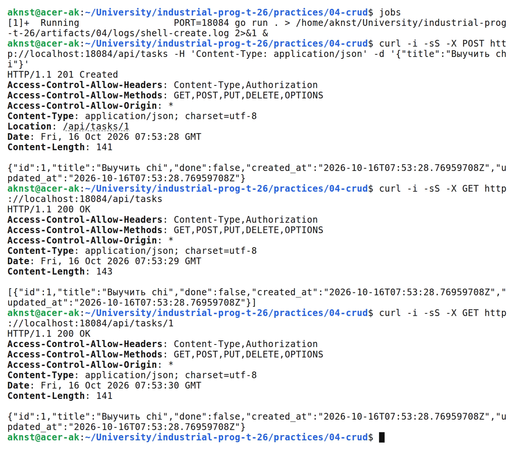
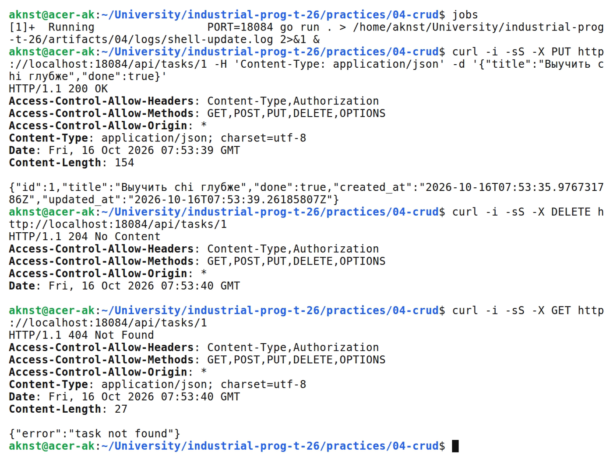
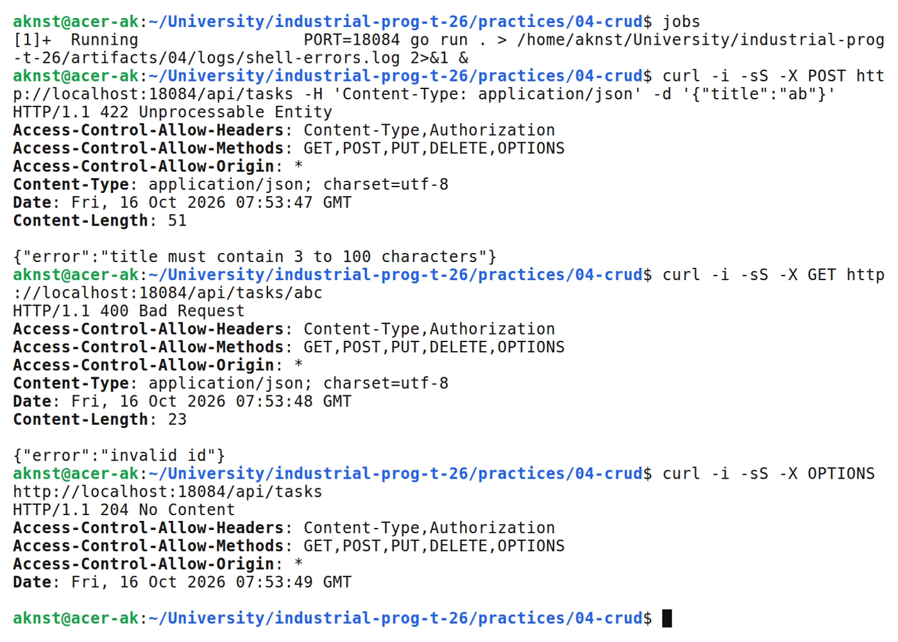

# Маршрутизация chi и CRUD сервис задач

**Цель:** Реализовать CRUD задач через chi и проверить middleware.

**Выполнил:** студент Арефьев К. В., группа ЭФМО-01-26.

**Окружение и исходники:** Ubuntu 24.04, WSL 2, Linux x86_64; go version go1.27.2 linux/amd64.

[https://github.com/aknst/industrial-prog-t-26/tree/main/practices/04-crud](https://github.com/aknst/industrial-prog-t-26/tree/main/practices/04-crud)

**Реализация:**

Через chi реализованы POST, GET списка и элемента, PUT и DELETE по адресу /api/tasks.

Файл `internal/task/handler.go`.

```go
func (h *Handler) Routes() chi.Router {
    r := chi.NewRouter()
    r.Get("/", h.list)
    r.Post("/", h.create)
    r.Get("/{id}", h.get)
    r.Put("/{id}", h.update)
    r.Delete("/{id}", h.delete)
    return r
}
```

Задачи хранятся в памяти. Добавлены фильтр done, пагинация и проверка названия длиной 3–100 символов.

Подключены RequestID, Recoverer, логирование и CORS. OPTIONS и DELETE возвращают 204 без тела.

Файл `pkg/middleware/cors.go`.

```go
func SimpleCORS(next http.Handler) http.Handler {
    return http.HandlerFunc(func(w http.ResponseWriter, r *http.Request) {
        w.Header().Set("Access-Control-Allow-Origin", "*")
        w.Header().Set("Access-Control-Allow-Methods", "GET,POST,PUT,DELETE,OPTIONS")
        w.Header().Set("Access-Control-Allow-Headers", "Content-Type,Authorization")
        if r.Method == "OPTIONS" {
            w.WriteHeader(204)
            return
        }
        next.ServeHTTP(w, r)
    })
}
```

Тест проверяет цикл CRUD, коды ошибок, CORS и пагинацию.

**Проверка:**

В таблице 1 представлены результаты запросов.

| Метод и маршрут | Ожидалось | Получено |
| :--- | :---: | :---: |
| `POST /api/tasks` | 201 | 201 |
| `GET /api/tasks` | 200 | 200 |
| `GET /api/tasks/1` | 200 | 200 |
| `POST /api/tasks` | 422 | 422 |
| `GET /api/tasks/abc` | 400 | 400 |
| `OPTIONS /api/tasks` | 204 | 204 |
| `PUT /api/tasks/1` | 200 | 200 |
| `DELETE /api/tasks/1` | 204 | 204 |
| `GET /api/tasks/1` | 404 | 404 |

Выполнены go vet и go test.

На рисунке 1 представлен вывод команд.



*Рисунок 1 — Создание задачи и чтение коллекции*

На рисунке 2 представлен вывод команд.



*Рисунок 2 — Обновление и удаление задачи*

На рисунке 3 представлен вывод команд.



*Рисунок 3 — Валидация и CORS*

**Вывод:** CRUD, CORS и валидация работают. Проверены успешные запросы и ошибки.
