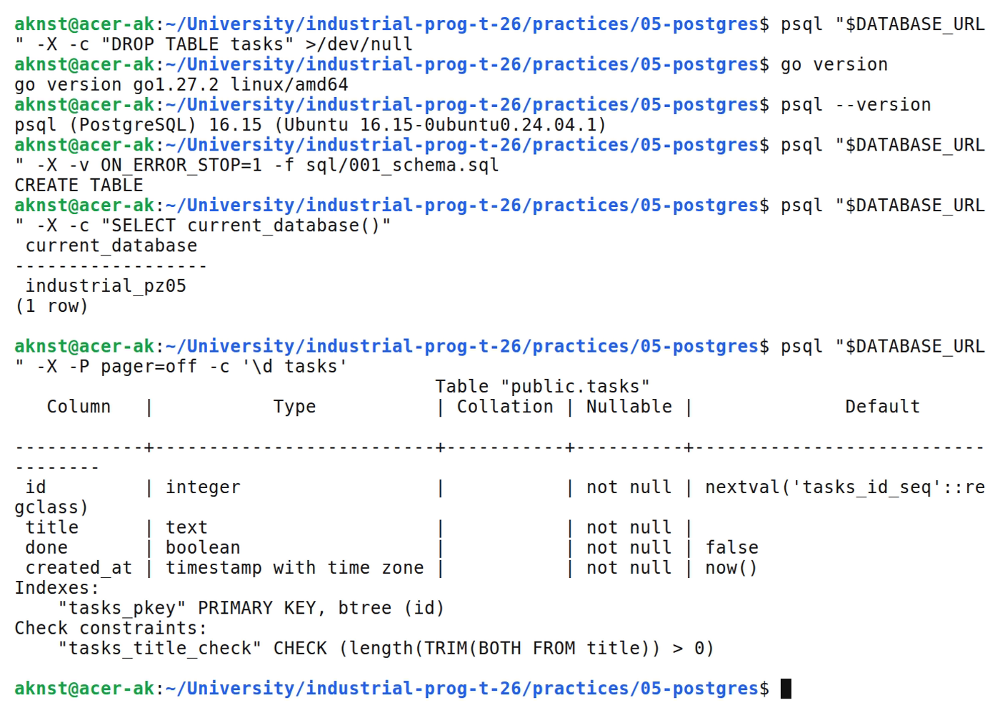
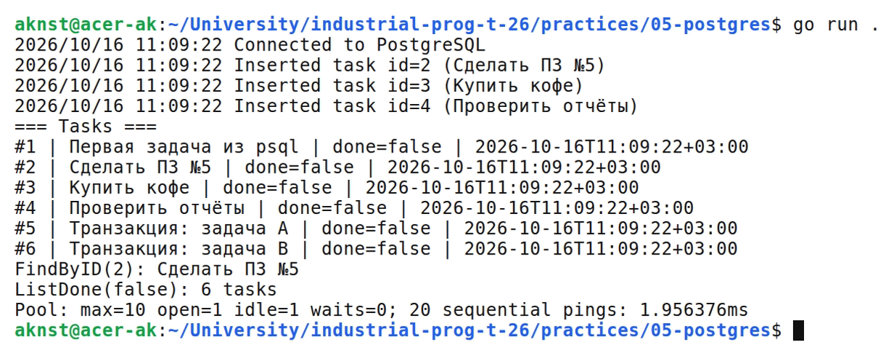
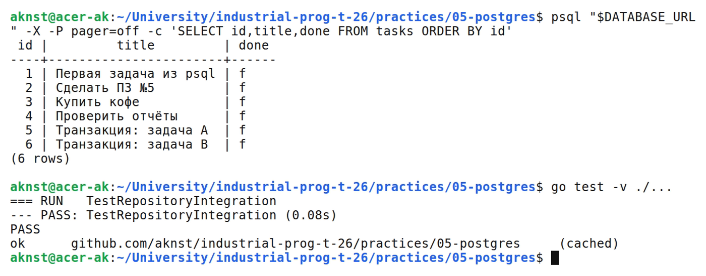

# Подключение к PostgreSQL через database/sql

**Цель:** Выполнить INSERT/SELECT в PostgreSQL через database/sql и проверить транзакции.

**Выполнил:** студент Арефьев К. В., группа ЭФМО-01-26.

**Окружение и исходники:** Ubuntu 24.04, WSL 2, Linux x86_64; go version go1.27.2 linux/amd64. psql (PostgreSQL) 16.15 (Ubuntu 16.15-0ubuntu0.24.04.1).

[https://github.com/aknst/industrial-prog-t-26/tree/main/practices/05-postgres](https://github.com/aknst/industrial-prog-t-26/tree/main/practices/05-postgres)

**Реализация:**

Созданы база industrial_pz05 и таблица tasks. Подключение читается из DATABASE_URL; используется драйвер pgx для database/sql.

*sql.DB управляет пулом: максимум 10 соединений, 5 простаивающих, срок жизни 30 минут. PingContext проверяет подключение. Для последовательной программы используется одно соединение.

Файл `db.go`.

```go
func openDB(ctx context.Context, dsn string) (*sql.DB, error) {
    db, err := sql.Open("pgx", dsn)
    if err != nil {
        return nil, err
    }
    db.SetMaxOpenConns(10)
    db.SetMaxIdleConns(5)
    db.SetConnMaxLifetime(30 * time.Minute)
    ping, cancel := context.WithTimeout(ctx, 2*time.Second)
    defer cancel()
    if err := db.PingContext(ping); err != nil {
        db.Close()
        return nil, fmt.Errorf("ping postgres: %w", err)
    }
    return db, nil
}
```

Query читает набор строк, QueryRow — одну строку, Exec выполняет команду без набора результатов. Значения передаются плейсхолдерами $1 и $2. Реализованы ListDone и FindByID.

CreateMany выполняет вставки в транзакции. Интеграционный тест на industrial_pz05_test подтвердил откат при ошибке CHECK и безопасную передачу SQL-подобного текста.

Файл `repository.go`.

```go
func (r *Repo) CreateMany(ctx context.Context, titles []string) error {
    tx, err := r.DB.BeginTx(ctx, nil)
    if err != nil {
        return err
    }
    defer tx.Rollback()
    for _, title := range titles {
        if _, err := tx.ExecContext(ctx, `INSERT INTO tasks(title) VALUES($1)`, title); err != nil {
            return fmt.Errorf("batch insert: %w", err)
        }
    }
    return tx.Commit()
}
```

Пул использовал одно соединение без ожиданий. Измерение времени приведено на рисунке 2.

**Проверка:**

Программа и запросы выполнены на PostgreSQL. Интеграционный тест подтвердил откат ошибочной массовой вставки и параметризацию.

На рисунке 1 представлен вывод команд.



*Рисунок 1 — Версии Go и PostgreSQL и структура таблицы*

На рисунке 2 представлен вывод команд.



*Рисунок 2 — Вывод консольной программы и статистика пула*

На рисунке 3 представлен вывод команд.



*Рисунок 3 — Контрольный SELECT и интеграционный тест*

**Вывод:** INSERT/SELECT выполнены. Интеграционный тест подтвердил параметризацию и откат транзакции.
