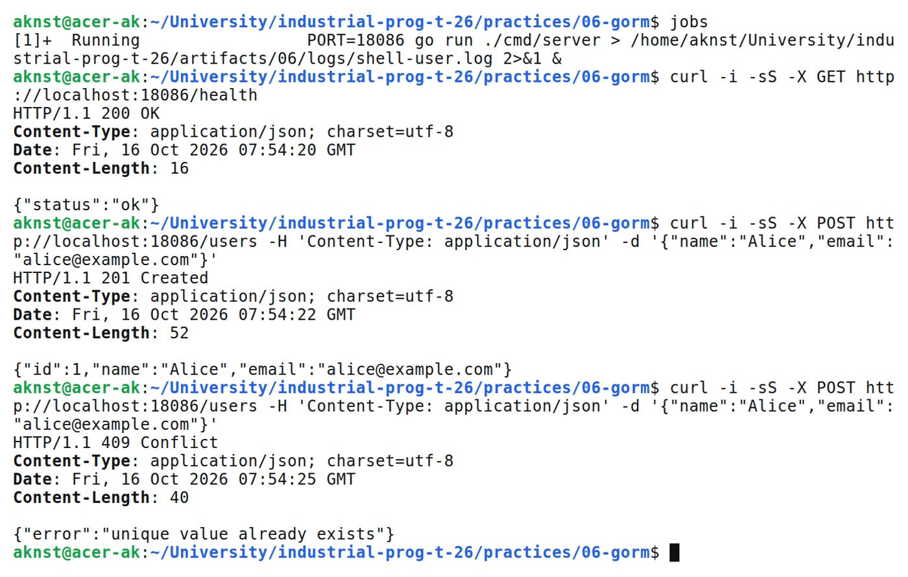
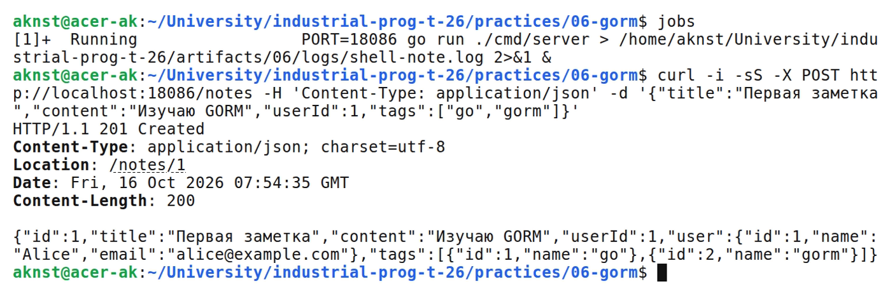
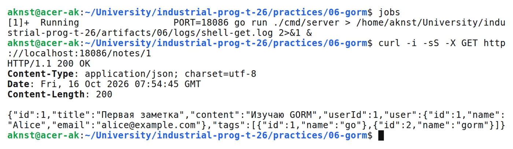
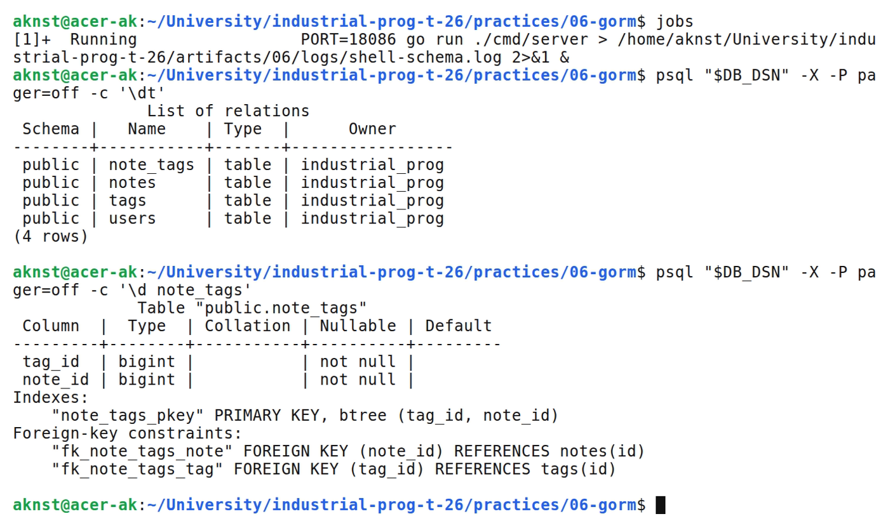

# GORM модели миграции и связи между таблицами

**Цель:** Создать модели и связи GORM и проверить REST API заметок.

**Выполнил:** студент Арефьев К. В., группа ЭФМО-01-26.

**Окружение и исходники:** Ubuntu 24.04, WSL 2, Linux x86_64; go version go1.27.2 linux/amd64. psql (PostgreSQL) 16.15 (Ubuntu 16.15-0ubuntu0.24.04.1).

[https://github.com/aknst/industrial-prog-t-26/tree/main/practices/06-gorm](https://github.com/aknst/industrial-prog-t-26/tree/main/practices/06-gorm)

**Реализация:**

GORM сопоставляет структуры и таблицы и сокращает код CRUD. SQL остаётся нужен для сложных запросов. AutoMigrate создаёт схему при запуске.

Модели User, Note и Tag описывают связи 1:N и M:N через note_tags. Email и имя тега уникальны.

Файл `internal/models/models.go`.

```go
type User struct {
    ID        uint   `gorm:"primaryKey"`
    Name      string `gorm:"size:100;not null"`
    Email     string `gorm:"size:200;uniqueIndex;not null"`
    Notes     []Note
    CreatedAt time.Time
    UpdatedAt time.Time
}
type Note struct {
    ID        uint   `gorm:"primaryKey"`
    Title     string `gorm:"size:200;not null"`
    Content   string `gorm:"type:text"`
    UserID    uint   `gorm:"not null;index"`
    User      User   `gorm:"constraint:OnUpdate:CASCADE,OnDelete:RESTRICT;"`
    Tags      []Tag  `gorm:"many2many:note_tags;"`
    CreatedAt time.Time
    UpdatedAt time.Time
}
type Tag struct {
    ID        uint   `gorm:"primaryKey"`
    Name      string `gorm:"size:50;uniqueIndex;not null"`
    Notes     []Note `gorm:"many2many:note_tags;"`
    CreatedAt time.Time
    UpdatedAt time.Time
}
```

POST /users создаёт автора, POST /notes — заметку с тегами. GET /notes/{id} загружает автора и теги через Preload.

Файл `internal/httpapi/handlers.go`.

```go
func (h *Handlers) GetNote(w http.ResponseWriter, r *http.Request) {
    id, err := strconv.ParseUint(chi.URLParam(r, "id"), 10, 32)
    if err != nil || id == 0 {
        fail(w, 400, "invalid id")
        return
    }
    var note models.Note
    if err := h.db.WithContext(r.Context()).Preload("User").Preload("Tags").First(&note, uint(id)).Error; err != nil {
        dbError(w, err)
        return
    }
    write(w, 200, toNote(note))
}
```

Создание заметки выполняется в транзакции. Повторный email даёт 409, неверный автор — 400, отсутствующая заметка — 404.

**Проверка:**

В таблице 1 представлены результаты запросов.

| Метод и маршрут | Ожидалось | Получено |
| :--- | :---: | :---: |
| `POST /users` | 201 | 201 |
| `POST /notes` | 201 | 201 |
| `GET /notes/1` | 200 | 200 |
| `GET /health` | 200 | 200 |
| `POST /users` | 409 | 409 |

Выполнены go vet и go test.

На рисунке 1 представлен вывод команд.



*Рисунок 1 — Создание пользователя и проверка уникальности*

На рисунке 2 представлен вывод команд.



*Рисунок 2 — Создание заметки с тегами*

На рисунке 3 представлен вывод команд.



*Рисунок 3 — Получение заметки с автором и тегами*

На рисунке 4 представлен вывод команд.



*Рисунок 4 — Таблицы и связь многие ко многим*

**Вывод:** Миграция создала таблицы и связи. Preload возвращает автора и теги заметки.
