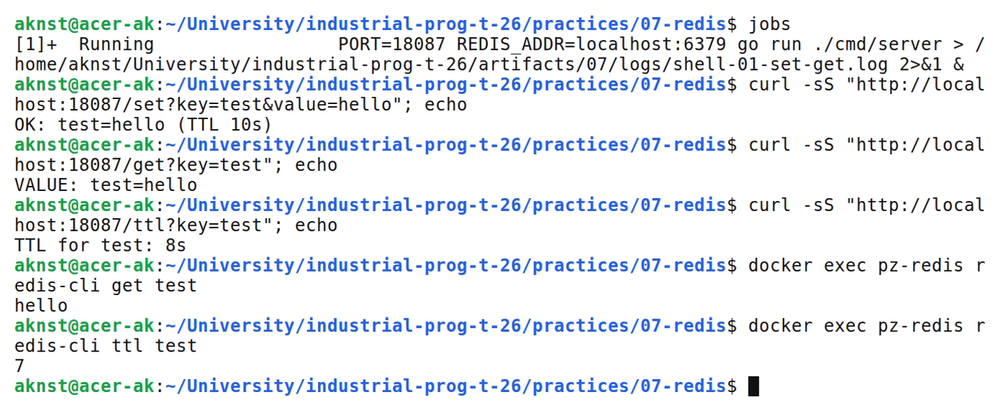
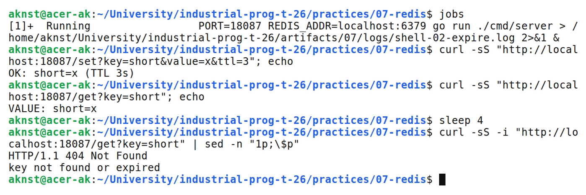
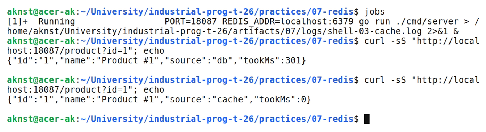

# Подключение и работа с Redis: SET/GET, TTL, простой кэш

**Цель:** Освоить SET, GET и TTL в Redis из Go и реализовать простой кэш для API.

**Выполнил:** студент Арефьев К. В., группа ЭФМО-01-26.

**Окружение и исходники:** Ubuntu 24.04, WSL 2, Linux x86_64; go version go1.27.2 linux/amd64. Redis 7 (Docker, redis:7-alpine), клиент go-redis v9.

[https://github.com/aknst/industrial-prog-t-26/tree/main/practices/07-redis](https://github.com/aknst/industrial-prog-t-26/tree/main/practices/07-redis)

**Реализация:**

Redis — in-memory хранилище «ключ–значение»: данные лежат в памяти, поэтому чтение занимает миллисекунды. TTL задаёт срок жизни ключа: по истечении Redis удаляет его сам. Для кэша это защита от устаревших данных. Если приложение читает «протухший» ключ, Redis отвечает как на отсутствующий, и приложение идёт за данными в основную БД.

Пакет internal/cache оборачивает клиент go-redis. Каждая операция получает контекст с таймаутом 2 секунды, а промах кэша возвращается как ErrMiss.

Файл `internal/cache/cache.go`.

```go
func (c *Cache) Get(ctx context.Context, key string) (string, error) {
    ctx, cancel := context.WithTimeout(ctx, opTimeout)
    defer cancel()
    val, err := c.rdb.Get(ctx, key).Result()
    if errors.Is(err, redis.Nil) {
        return "", ErrMiss
    }
    return val, err
}
```

Метод GetOrLoad реализует схему cache-aside: чтение кэша, при промахе загрузка из источника и запись в Redis с TTL.

Файл `internal/cache/cache.go`.

```go
func (c *Cache) GetOrLoad(ctx context.Context, key string, ttl time.Duration, load func(context.Context) (string, error)) (string, bool, error) {
    val, err := c.Get(ctx, key)
    if err == nil {
        return val, true, nil
    }
    if !errors.Is(err, ErrMiss) {
        return "", false, err
    }
    val, err = load(ctx)
    if err != nil {
        return "", false, err
    }
    if err := c.Set(ctx, key, val, ttl); err != nil {
        return "", false, err
    }
    return val, false, nil
}
```

Эндпоинты /set, /get, /ttl и /del работают с ключами, /product демонстрирует кэш: первый запрос идёт в «медленную БД» на 300 мс, повторный отдаётся из Redis. Пустые параметры дают 400, отсутствующий или истёкший ключ — 404. Тесты используют miniredis и проверяют истечение TTL.

**Проверка:**

В таблице 1 представлены результаты запросов.

Таблица 1 — Результаты проверки запросов

| Метод и маршрут | Ожидалось | Получено |
| :--- | :---: | :---: |
| `GET /health` | 200 | 200 |
| `GET /set?key=test&value=hello` | 200 | 200 |
| `GET /get?key=test` | 200 | 200 |
| `GET /ttl?key=test` | 200 | 200 |
| `GET /set?key=short&value=x&ttl=2` | 200 | 200 |
| `GET /get?key=short` | 404 | 404 |
| `GET /product?id=1` | 200 | 200 |
| `GET /set?key=a` | 400 | 400 |

Выполнены go vet и go test.

На рисунке 1 представлен вывод команд.



*Рисунок 1 — Команды set, get и ttl и проверка ключа в Redis*

На рисунке 2 представлен вывод команд.



*Рисунок 2 — Истечение TTL: ключ удалён Redis*

На рисунке 3 представлен вывод команд.



*Рисунок 3 — Первый запрос из «БД» и повторный из кэша*

**Вывод:** Реализованы SET, GET, TTL и cache-aside. Повторный запрос выполняется из Redis почти мгновенно, а ключи удаляются по TTL. Тесты пройдены.
