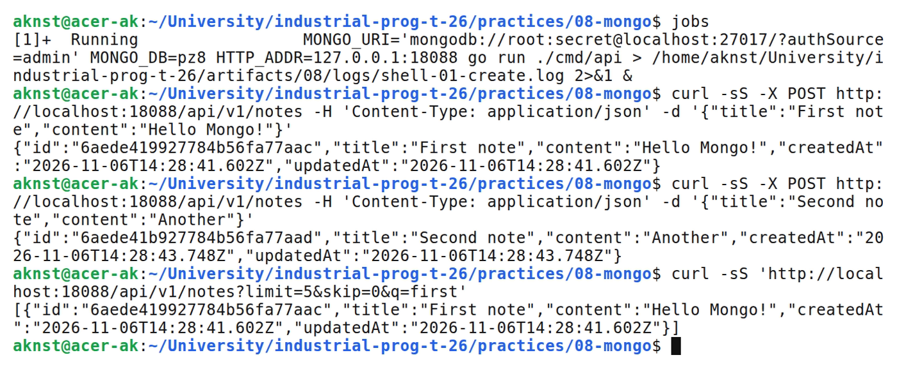
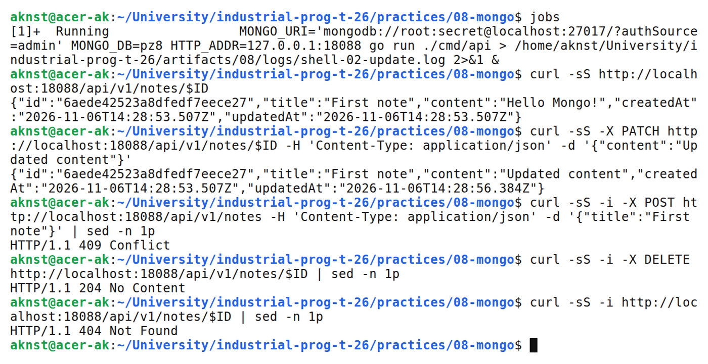
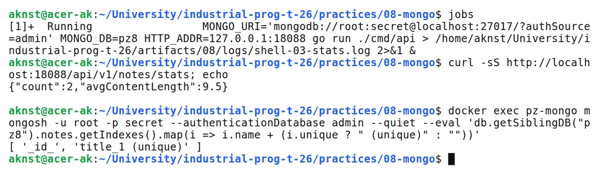

# Работа с MongoDB: подключение, коллекция, CRUD

**Цель:** Подключиться к MongoDB из Go, создать коллекцию с индексом и реализовать CRUD для заметок.

**Выполнил:** студент Арефьев К. В., группа ЭФМО-01-26.

**Окружение и исходники:** Ubuntu 24.04, WSL 2, Linux x86_64; go version go1.27.2 linux/amd64. MongoDB 7 (Docker, mongo:7), драйвер mongo-driver v1.

[https://github.com/aknst/industrial-prog-t-26/tree/main/practices/08-mongo](https://github.com/aknst/industrial-prog-t-26/tree/main/practices/08-mongo)

**Реализация:**

MongoDB — документная СУБД: данные хранятся как BSON-документы в коллекциях без жёсткой схемы, а _id имеет тип ObjectID. Сервис работает с коллекцией notes базы pz8.

Подключение выполняется с таймаутами: 10 секунд на соединение и 3 секунды на ping.

При создании репозитория строится уникальный индекс по title. Повторный заголовок даёт 409. Поиск использует $regex без учёта регистра; строка пользователя экранируется через QuoteMeta.

Файл `internal/db/mongo.go`.

```go
func ConnectMongo(ctx context.Context, uri, dbName string) (*MongoDeps, error) {
    dialCtx, cancel := context.WithTimeout(ctx, 10*time.Second)
    defer cancel()
    cli, err := mongo.Connect(dialCtx, options.Client().ApplyURI(uri).SetServerSelectionTimeout(5*time.Second))
    if err != nil {
        return nil, err
    }
    pingCtx, cancelPing := context.WithTimeout(ctx, 3*time.Second)
    defer cancelPing()
    if err := cli.Ping(pingCtx, nil); err != nil {
        _ = cli.Disconnect(ctx)
        return nil, err
    }
    return &MongoDeps{Client: cli, Database: cli.Database(dbName)}, nil
}
```

Частичное обновление использует оператор $set: меняются только переданные поля и updatedAt. Неверный ObjectID обрабатывается как «не найдено». Каждый запрос к БД ограничен таймаутом 5 секунд.

Файл `internal/notes/repo.go`.

```go
func (r *Repo) Update(ctx context.Context, idHex string, title, content *string) (Note, error) {
    oid, err := primitive.ObjectIDFromHex(idHex)
    if err != nil {
        return Note{}, ErrNotFound
    }
    set := bson.M{"updatedAt": time.Now().UTC().Truncate(time.Millisecond)}
    if title != nil {
        set["title"] = *title
    }
    if content != nil {
        set["content"] = *content
    }
    after := options.FindOneAndUpdate().SetReturnDocument(options.After)
    var updated Note
    err = r.col.FindOneAndUpdate(ctx, bson.M{"_id": oid}, bson.M{"$set": set}, after).Decode(&updated)
    if err != nil {
        if errors.Is(err, mongo.ErrNoDocuments) {
            return Note{}, ErrNotFound
        }
        if mongo.IsDuplicateKeyError(err) {
            return Note{}, ErrDuplicate
        }
        return Note{}, err
    }
    return updated, nil
}
```

Дополнительно реализованы пагинация по курсору (after) и aggregation pipeline /stats. Тесты репозитория выполнены на реальной MongoDB.

**Проверка:**

В таблице 1 представлены результаты запросов.

Таблица 1 — Результаты проверки запросов

| Метод и маршрут | Ожидалось | Получено |
| :--- | :---: | :---: |
| `POST /api/v1/notes` | 201 | 201 |
| `GET /api/v1/notes?limit=5&skip=0&q=first` | 200 | 200 |
| `GET /api/v1/notes/6aede3c96085aee52943bc94` | 200 | 200 |
| `PATCH /api/v1/notes/6aede3c96085aee52943bc94` | 200 | 200 |
| `POST /api/v1/notes` | 409 | 409 |
| `POST /api/v1/notes` | 400 | 400 |
| `GET /api/v1/notes/stats` | 200 | 200 |
| `DELETE /api/v1/notes/6aede3c96085aee52943bc94` | 204 | 204 |
| `GET /api/v1/notes/6aede3c96085aee52943bc94` | 404 | 404 |
| `GET /api/v1/notes/not-an-id` | 404 | 404 |

Выполнены go vet и go test.

На рисунке 1 представлен вывод команд.



*Рисунок 1 — Создание заметок и поиск*

На рисунке 2 представлен вывод команд.



*Рисунок 2 — Получение, частичное обновление, конфликт и удаление*

На рисунке 3 представлен вывод команд.



*Рисунок 3 — Статистика и индексы коллекции*

**Вывод:** Реализованы CRUD, уникальный индекс, поиск и две схемы пагинации. Таймауты защищают сервис от зависаний. Тесты на MongoDB пройдены.
