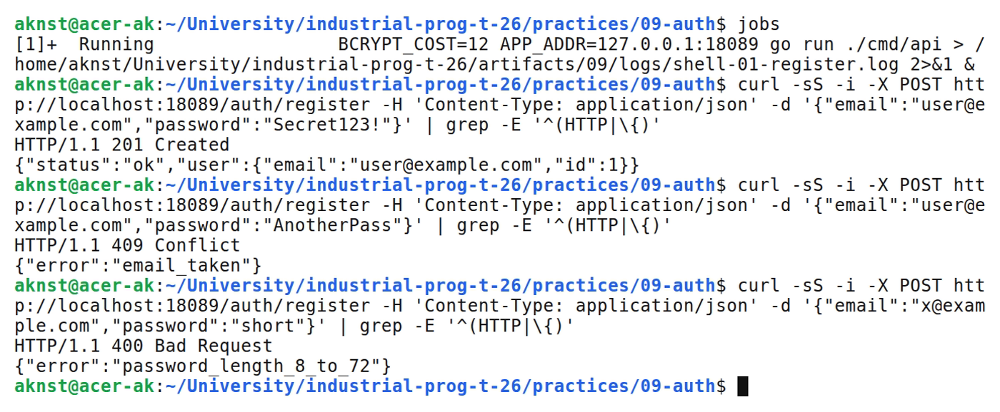
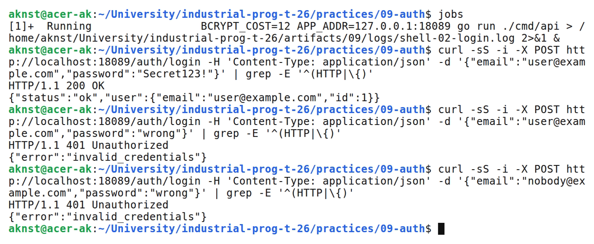
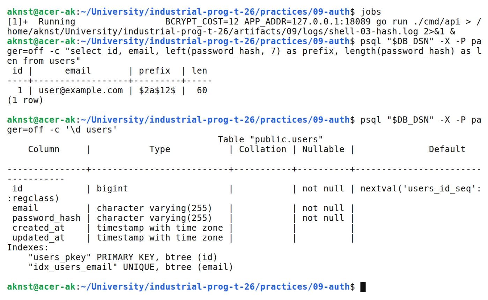

# Регистрация и вход пользователей, хэширование паролей с bcrypt

**Цель:** Реализовать регистрацию и вход с безопасным хранением паролей на основе bcrypt.

**Выполнил:** студент Арефьев К. В., группа ЭФМО-01-26.

**Окружение и исходники:** Ubuntu 24.04, WSL 2, Linux x86_64; go version go1.27.2 linux/amd64. psql (PostgreSQL) 16.15 (Ubuntu 16.15-0ubuntu0.24.04.1). chi v5, GORM, golang.org/x/crypto/bcrypt.

[https://github.com/aknst/industrial-prog-t-26/tree/main/practices/09-auth](https://github.com/aknst/industrial-prog-t-26/tree/main/practices/09-auth)

**Реализация:**

Пароль нельзя хранить в открытом виде: утечка базы раскрывает все аккаунты. Быстрые хэши MD5 и SHA-256 легко перебираются и не содержат соли. bcrypt добавляет случайную соль и настраиваемую стоимость, поэтому одинаковые пароли дают разные хэши. В базе хранится только хэш вида \$2a\$12\$.

Структура: cmd/api, internal/http/handlers, internal/core, internal/repo, internal/platform/config. Таблица users создаётся через AutoMigrate с уникальным индексом по email.

POST /auth/register проверяет email и длину пароля (8–72 байта), хэширует пароль через bcrypt.GenerateFromPassword и сохраняет пользователя. Повторный email даёт 409.

Файл `internal/http/handlers/auth.go`.

```go
func (h *AuthHandler) Register(w http.ResponseWriter, r *http.Request) {
    var in credentials
    if !decode(w, r, &in) {
        return
    }
    in.Email = normalizeEmail(in.Email)
    if _, err := mail.ParseAddress(in.Email); err != nil || len(in.Email) > 255 {
        writeErr(w, http.StatusBadRequest, "invalid_email")
        return
    }
    if len(in.Password) < minPasswordLen || len(in.Password) > maxPasswordLen {
        writeErr(w, http.StatusBadRequest, "password_length_8_to_72")
        return
    }

    hash, err := bcrypt.GenerateFromPassword([]byte(in.Password), h.BcryptCost)
    if err != nil {
        writeErr(w, http.StatusInternalServerError, "hash_failed")
        return
    }
    u := core.User{Email: in.Email, PasswordHash: string(hash)}
    if err := h.Users.Create(r.Context(), &u); err != nil {
        if errors.Is(err, repo.ErrEmailTaken) {
            writeErr(w, http.StatusConflict, "email_taken")
            return
        }
        writeErr(w, http.StatusInternalServerError, "db_error")
        return
    }
    writeJSON(w, http.StatusCreated, authResp{Status: "ok", User: map[string]any{"id": u.ID, "email": u.Email}})
}
```

POST /auth/login сравнивает пароль через bcrypt.CompareHashAndPassword. Для неизвестного email выполняется сравнение с фиктивным хэшем, а ответ одинаков в обоих случаях: invalid_credentials, 401.

Файл `internal/http/handlers/auth.go`.

```go
func (h *AuthHandler) Login(w http.ResponseWriter, r *http.Request) {
    var in credentials
    if !decode(w, r, &in) {
        return
    }
    in.Email = normalizeEmail(in.Email)
    if in.Email == "" || in.Password == "" {
        writeErr(w, http.StatusBadRequest, "email_and_password_required")
        return
    }

    u, err := h.Users.ByEmail(r.Context(), in.Email)
    if err != nil {
        if !errors.Is(err, repo.ErrUserNotFound) {
            writeErr(w, http.StatusInternalServerError, "db_error")
            return
        }
        _ = bcrypt.CompareHashAndPassword(h.dummyHash, []byte(in.Password))
        writeErr(w, http.StatusUnauthorized, "invalid_credentials")
        return
    }
    if bcrypt.CompareHashAndPassword([]byte(u.PasswordHash), []byte(in.Password)) != nil {
        writeErr(w, http.StatusUnauthorized, "invalid_credentials")
        return
    }
    // В ПЗ 10 здесь выдаётся JWT; пока возвращаем только статус.
    writeJSON(w, http.StatusOK, authResp{Status: "ok", User: map[string]any{"id": u.ID, "email": u.Email}})
}
```

Параметры задаются переменными DB_DSN, BCRYPT_COST (по умолчанию 12) и APP_ADDR.

**Проверка:**

В таблице 1 представлены результаты запросов.

Таблица 1 — Результаты проверки запросов

| Метод и маршрут | Ожидалось | Получено |
| :--- | :---: | :---: |
| `POST /auth/register` | 201 | 201 |
| `POST /auth/register` | 409 | 409 |
| `POST /auth/register` | 400 | 400 |
| `POST /auth/login` | 200 | 200 |
| `POST /auth/login` | 401 | 401 |

Выполнены go vet и go test.

На рисунке 1 представлен вывод команд.



*Рисунок 1 — Регистрация, повторная регистрация и короткий пароль*

На рисунке 2 представлен вывод команд.



*Рисунок 2 — Вход с верным и неверным паролем*

На рисунке 3 представлен вывод команд.



*Рисунок 3 — Хэш пароля и схема таблицы users*

**Вывод:** Пароли хранятся только в виде bcrypt-хэшей с солью. Вход возвращает одинаковую ошибку для любых неверных данных. Тесты на PostgreSQL пройдены.
