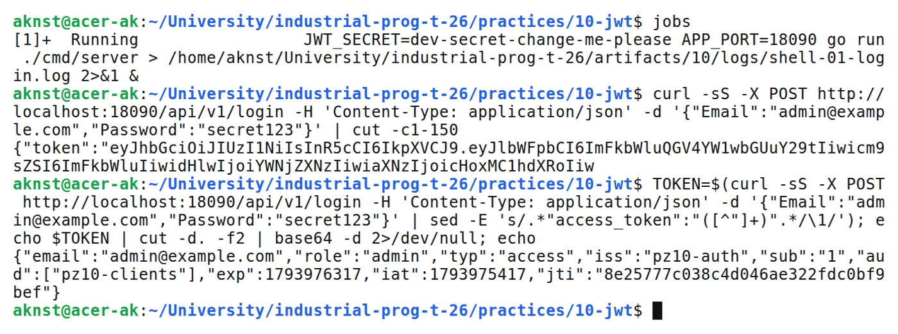
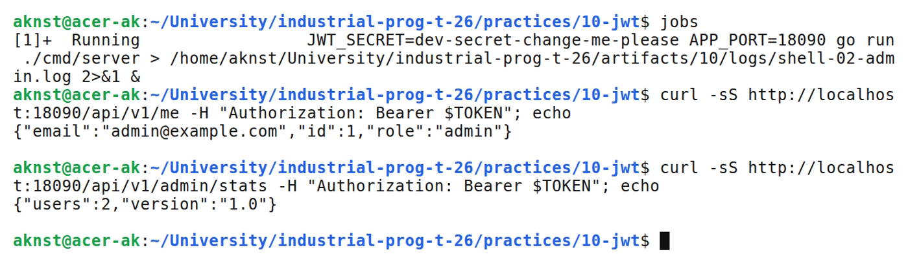
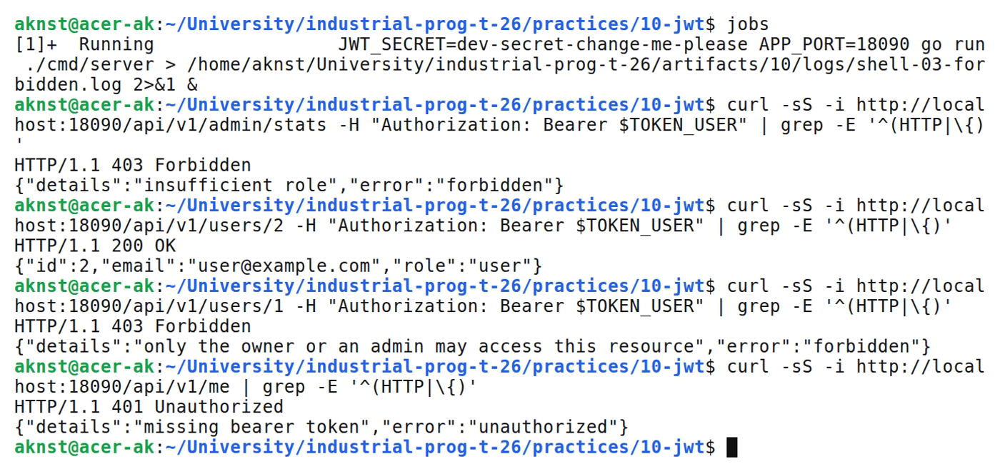
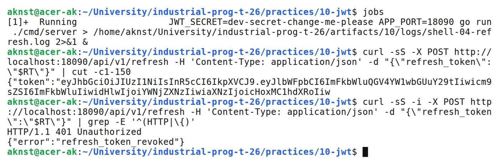
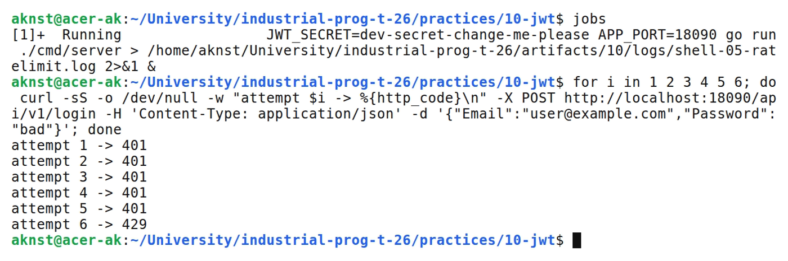

# JWT-аутентификация и middleware авторизации

**Цель:** Выдавать и проверять JWT, защитить маршруты middleware и добавить refresh-токены и правило ABAC.

**Выполнил:** студент Арефьев К. В., группа ЭФМО-01-26.

**Окружение и исходники:** Ubuntu 24.04, WSL 2, Linux x86_64; go version go1.27.2 linux/amd64. chi v5, golang-jwt/jwt v5, golang.org/x/crypto/bcrypt.

[https://github.com/aknst/industrial-prog-t-26/tree/main/practices/10-jwt](https://github.com/aknst/industrial-prog-t-26/tree/main/practices/10-jwt)

**Реализация:**

JWT состоит из заголовка, клеймов и подписи HMAC-SHA256. Сервер не хранит сессий: достаточно проверить подпись и срок exp. Аутентификация отвечает на вопрос «кто ты» и даёт 401, авторизация — «что тебе можно» и даёт 403, поэтому AuthZ стоит после AuthN.

Токен содержит sub, email, role, тип (access или refresh), iss, aud, iat, exp и jti. Допустим только HS256, exp обязателен, тип токена проверяется отдельно.

Middleware AuthN читает Authorization: Bearer, проверяет токен и кладёт клеймы в контекст. AuthZRoles реализует RBAC, AuthZSelfOrRoles — правило ABAC: user получает /api/v1/users/{id} только при id, равном sub.

Файл `internal/platform/jwt/jwt.go`.

```go
func (h *HS256) Parse(tokenStr, wantType string) (*Claims, error) {
    claims := &Claims{}
    tok, err := jwtlib.ParseWithClaims(tokenStr, claims,
        func(*jwtlib.Token) (any, error) { return h.secret, nil },
        jwtlib.WithValidMethods([]string{"HS256"}),
        jwtlib.WithAudience(Audience),
        jwtlib.WithIssuer(Issuer),
        jwtlib.WithExpirationRequired(),
    )
    if err != nil {
        return nil, err
    }
    if !tok.Valid {
        return nil, errors.New("invalid token")
    }
    if claims.Type != wantType {
        return nil, ErrWrongType
    }
    return claims, nil
}
```

При входе выдаются access (15 минут) и refresh (7 дней). POST /api/v1/refresh отзывает старый refresh-токен через in-memory blacklist и выдаёт новую пару; повторное использование даёт 401.

Файл `internal/http/middleware/authz.go`.

```go
func AuthZSelfOrRoles(param string, privileged ...string) func(http.Handler) http.Handler {
    set := toSet(privileged)
    return func(next http.Handler) http.Handler {
        return http.HandlerFunc(func(w http.ResponseWriter, r *http.Request) {
            c, ok := jwt.ClaimsFrom(r.Context())
            if !ok {
                unauthorized(w, "authentication required")
                return
            }
            _, isPrivileged := set[c.Role]
            if !isPrivileged && chi.URLParam(r, param) != c.Subject {
                respond.Error(w, http.StatusForbidden, "forbidden", "only the owner or an admin may access this resource")
                return
            }
            next.ServeHTTP(w, r)
        })
    }
}
```

Дополнительно: ограничение попыток входа (5 за 5 минут с одного IP, ответ 429), единый JSON-формат ошибок и логирование.

**Проверка:**

В таблице 1 представлены результаты запросов.

Таблица 1 — Результаты проверки запросов

| Метод и маршрут | Ожидалось | Получено |
| :--- | :---: | :---: |
| `POST /api/v1/login` | 200 | 200 |
| `GET /api/v1/me` | 200 | 200 |
| `GET /api/v1/admin/stats` | 200 | 200 |
| `GET /api/v1/me` | 401 | 401 |
| `GET /api/v1/admin/stats` | 403 | 403 |
| `GET /api/v1/users/2` | 200 | 200 |
| `GET /api/v1/users/1` | 403 | 403 |
| `GET /api/v1/users/1` | 200 | 200 |
| `POST /api/v1/refresh` | 200 | 200 |
| `POST /api/v1/refresh` | 401 | 401 |
| `POST /api/v1/login` | 401 | 401 |
| `POST /api/v1/login` | 429 | 429 |

Выполнены go vet и go test.

На рисунке 1 представлен вывод команд.



*Рисунок 1 — Вход администратора и содержимое токена*

На рисунке 2 представлен вывод команд.



*Рисунок 2 — Маршруты /me и /admin/stats для admin*

На рисунке 3 представлен вывод команд.



*Рисунок 3 — Ответы 403 для user и правило ABAC*

На рисунке 4 представлен вывод команд.



*Рисунок 4 — Обновление токенов и повторное использование refresh*

На рисунке 5 представлен вывод команд.



*Рисунок 5 — Ограничение числа попыток входа*

**Вывод:** Маршруты защищены цепочкой AuthN и AuthZ, refresh-токены ротируются и отзываются. Blacklist хранится в памяти. Тесты пройдены.
