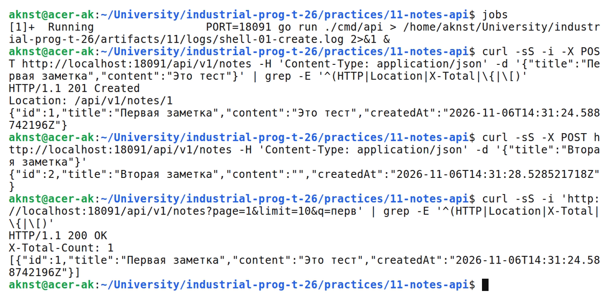
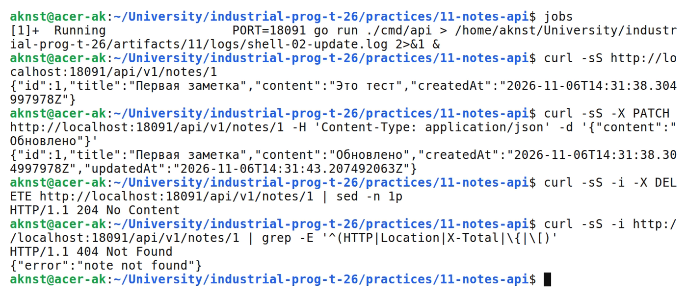
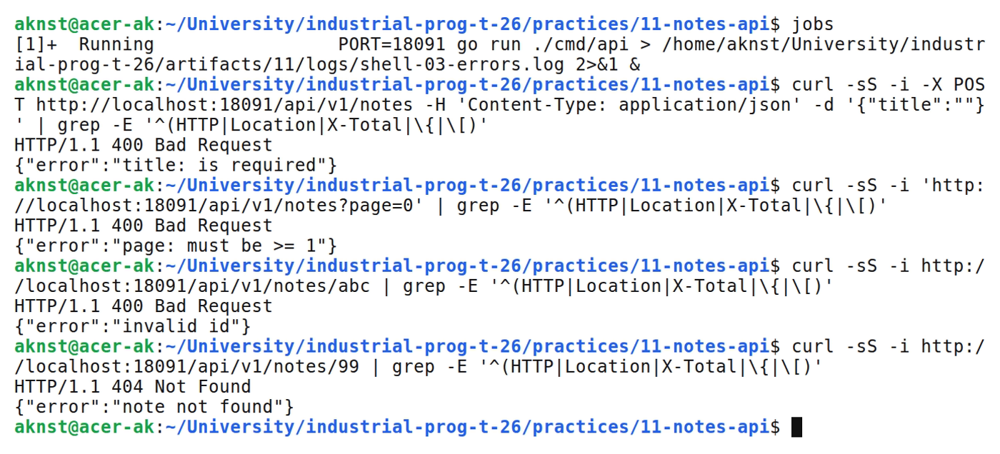

# Проектирование REST API: CRUD для заметок

**Цель:** Спроектировать REST API заметок и реализовать его в слоистой архитектуре.

**Выполнил:** студент Арефьев К. В., группа ЭФМО-01-26.

**Окружение и исходники:** Ubuntu 24.04, WSL 2, Linux x86_64; go version go1.27.2 linux/amd64. chi v5.

[https://github.com/aknst/industrial-prog-t-26/tree/main/practices/11-notes-api](https://github.com/aknst/industrial-prog-t-26/tree/main/practices/11-notes-api)

**Реализация:**

REST описывает систему как набор ресурсов (/api/v1/notes) и стандартные методы HTTP без состояния: POST создаёт (201), GET читает (200), PATCH обновляет (200), DELETE удаляет (204). Префикс /api/v1 позволяет менять API, не ломая клиентов.

Обработчики разбирают HTTP, сервис содержит бизнес-логику и валидацию, репозиторий хранит данные в памяти. Слои зависят друг от друга в одну сторону, поэтому тестируются отдельно.

Файл `internal/repo/note_mem.go`.

```go
func (r *NoteRepoMem) Create(n core.Note) (core.Note, error) {
    r.mu.Lock()
    defer r.mu.Unlock()
    r.next++
    n.ID = r.next
    n.UpdatedAt = nil
    r.notes[n.ID] = &n
    return n, nil
}
```

Репозиторий защищён RWMutex. Сервис проверяет title (1–200 символов), content (до 10000), page и limit.

Файл `internal/core/service/note_service.go`.

```go
func validateTitle(t string) (string, error) {
    t = strings.TrimSpace(t)
    if t == "" {
        return "", &ValidationError{"title", "is required"}
    }
    if utf8.RuneCountInString(t) > MaxTitleLen {
        return "", &ValidationError{"title", "must be at most 200 characters"}
    }
    return t, nil
}
```

Список поддерживает page, limit и поиск q; общее число записей передаётся в заголовке X-Total-Count. Ошибки имеют вид {"error":"..."}. Спецификация API записана в api/openapi.yaml.

**Проверка:**

В таблице 1 представлены результаты запросов.

Таблица 1 — Результаты проверки запросов

| Метод и маршрут | Ожидалось | Получено |
| :--- | :---: | :---: |
| `POST /api/v1/notes` | 201 | 201 |
| `GET /api/v1/notes?page=1&limit=10&q=перв` | 200 | 200 |
| `GET /api/v1/notes/1` | 200 | 200 |
| `PATCH /api/v1/notes/1` | 200 | 200 |
| `DELETE /api/v1/notes/1` | 204 | 204 |
| `GET /api/v1/notes/1` | 404 | 404 |
| `POST /api/v1/notes` | 400 | 400 |
| `GET /api/v1/notes?page=0` | 400 | 400 |
| `GET /api/v1/notes/abc` | 400 | 400 |

Выполнены go vet и go test.

На рисунке 1 представлен вывод команд.



*Рисунок 1 — Создание заметок и список с X-Total-Count*

На рисунке 2 представлен вывод команд.



*Рисунок 2 — Получение, обновление, удаление и повторное чтение*

На рисунке 3 представлен вывод команд.



*Рисунок 3 — Ответы 400 и 404*

**Вывод:** Реализованы CRUD, валидация и пагинация с корректными кодами HTTP. Репозиторий в памяти можно заменить на БД. Тесты пройдены.
