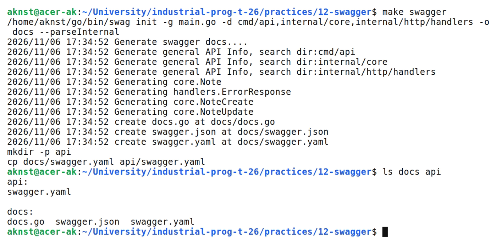
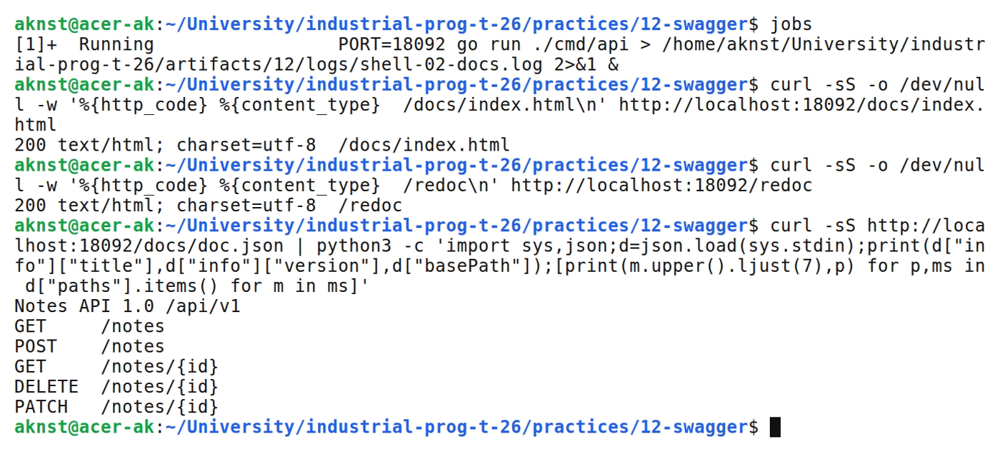
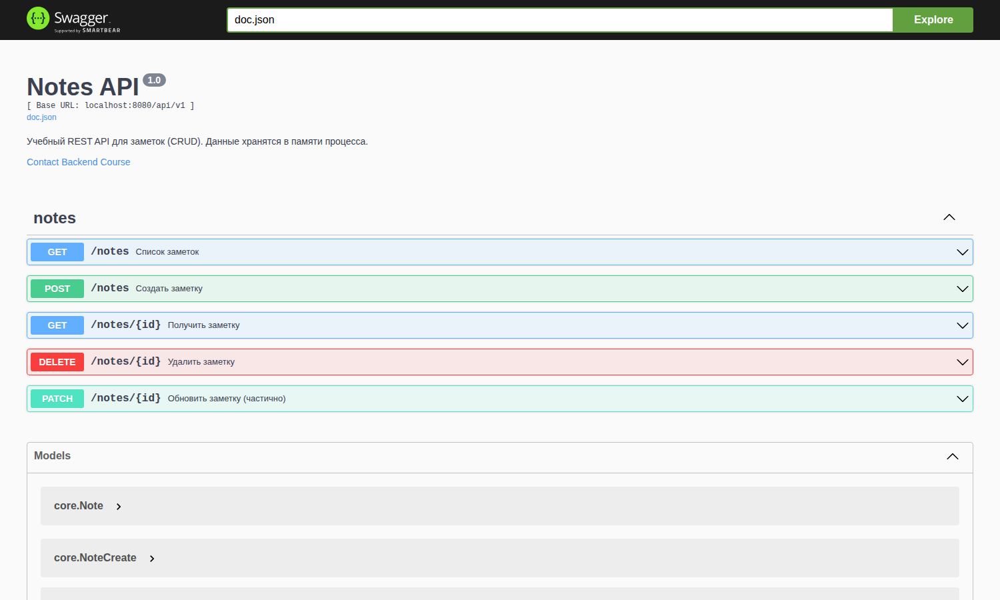

# Подключение Swagger/OpenAPI: автоматическая генерация документации

**Цель:** Подключить автогенерацию документации к API заметок и опубликовать Swagger UI на /docs.

**Выполнил:** студент Арефьев К. В., группа ЭФМО-01-26.

**Окружение и исходники:** Ubuntu 24.04, WSL 2, Linux x86_64; go version go1.27.2 linux/amd64. swag v1.16.4, http-swagger v1.3.4, chi v5.

[https://github.com/aknst/industrial-prog-t-26/tree/main/practices/12-swagger](https://github.com/aknst/industrial-prog-t-26/tree/main/practices/12-swagger)

**Реализация:**

OpenAPI — стандарт машиночитаемого описания REST API, Swagger — набор инструментов вокруг него. Выбран подход code-first: документация создаётся из аннотаций в комментариях утилитой swag и меняется вместе с кодом. Схема swag v1 соответствует Swagger 2.0.

Общие аннотации заданы в cmd/api/main.go: название, версия, контакты, host и BasePath /api/v1.

Аннотации над обработчиками описывают параметры, ответы и маршруты. Аннотированы все пять методов /notes, а модели Note, NoteCreate и NoteUpdate содержат теги example.

Файл `cmd/api/main.go`.

```go
// Package main Notes API server.
//
//  @title          Notes API
//  @version        1.0
//  @description    Учебный REST API для заметок (CRUD). Данные хранятся в памяти процесса.
//  @contact.name   Backend Course
//  @contact.email  example@university.ru
//  @host           localhost:8080
//  @BasePath       /api/v1
package main
```

Генерация выполняется командой make swagger, которая запускает swag init и экспортирует спецификацию в api/swagger.yaml. Swagger UI подключён на /docs, дополнительно доступна страница ReDoc на /redoc.

Файл `internal/http/handlers/notes.go`.

```go
// ListNotes godoc
//
//  @Summary        Список заметок
//  @Description    Возвращает страницу заметок, отсортированных по id, с фильтром по подстроке заголовка
//  @Tags           notes
//  @Produce        json
//  @Param          page    query       int     false   "Номер страницы (с 1)"          default(1)  minimum(1)
//  @Param          limit   query       int     false   "Размер страницы (1-100)"       default(20) minimum(1)  maximum(100)
//  @Param          q       query       string  false   "Поиск по подстроке title без учёта регистра"
//  @Success        200     {array}     core.Note
//  @Header         200     {integer}   X-Total-Count   "Общее количество заметок, подходящих под фильтр"
//  @Failure        400     {object}    ErrorResponse
//  @Failure        500     {object}    ErrorResponse
//  @Router         /notes [get]
```

Файл `internal/http/handlers/notes.go`.

```go
// CreateNote godoc
//
//  @Summary        Создать заметку
//  @Description    Создаёт заметку; title обязателен (до 200 символов), content необязателен (до 10000)
//  @Tags           notes
//  @Accept         json
//  @Produce        json
//  @Param          input   body        core.NoteCreate true    "Данные новой заметки"
//  @Success        201     {object}    core.Note
//  @Header         201     {string}    Location    "URL созданной заметки"
//  @Failure        400     {object}    ErrorResponse
//  @Failure        500     {object}    ErrorResponse
//  @Router         /notes [post]
```

Тест TestDocsAreServed проверяет, что в спецификации описаны все пять методов и схемы.

**Проверка:**

В таблице 1 представлены результаты запросов.

Таблица 1 — Результаты проверки запросов

| Метод и маршрут | Ожидалось | Получено |
| :--- | :---: | :---: |
| `POST /api/v1/notes` | 201 | 201 |
| `GET /api/v1/notes?page=1&limit=10&q=перв` | 200 | 200 |
| `GET /api/v1/notes/1` | 200 | 200 |
| `PATCH /api/v1/notes/1` | 200 | 200 |
| `DELETE /api/v1/notes/1` | 204 | 204 |
| `GET /api/v1/notes/1` | 404 | 404 |
| `POST /api/v1/notes` | 400 | 400 |
| `GET /api/v1/notes?page=0` | 400 | 400 |
| `GET /api/v1/notes/abc` | 400 | 400 |
| `GET /docs/index.html` | 200 | 200 |
| `GET /redoc` | 200 | 200 |
| `GET /docs/doc.json` | 200 | 200 |

Выполнены go vet и go test.

На рисунке 1 представлен вывод команд.



*Рисунок 1 — Генерация документации командой make swagger*

На рисунке 2 представлен вывод команд.



*Рисунок 2 — Спецификация и страницы документации*

На рисунке 3 представлен вывод команд.



*Рисунок 3 — Страница Swagger UI*

**Вывод:** Документация создаётся командой make swagger и публикуется в Swagger UI и ReDoc. Все пять методов описаны, тесты пройдены.
